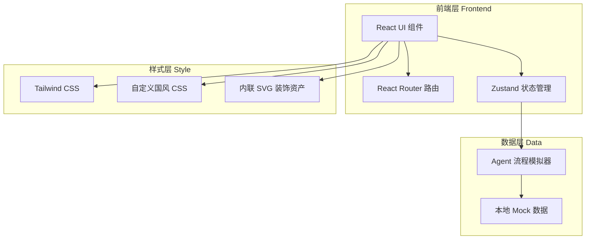

# 国风 AI Agent 应用界面 - 技术架构文档

## 1. 架构设计



## 2. 技术说明

- **前端框架**：React 18 + Vite
- **样式方案**：Tailwind CSS 3 + 自定义 CSS 变量（国风配色 token）+ Google Fonts（Ma Shan Zheng / Noto Serif SC / Noto Sans SC）
- **状态管理**：Zustand（轻量，适合单页对话状态）
- **路由**：React Router v6
- **动效**：CSS Animation + Framer Motion（用于卷轴展开、墨迹晕染等关键叙事动效）
- **后端**：无，纯前端 Mock
- **数据**：本地 TS 文件 mock 对话、任务节点、工具调用流程

## 3. 路由定义

| 路由 | 用途 |
|------|------|
| `/` | 首页：山水长卷 + 卷轴对话入口 + 多宝阁功能宫格 |
| `/chat` | 对话页：左侧行军图任务规划 + 右侧信笺对话流 |
| `/chat/:topic` | 对话页（带预设话题）：从首页多宝阁进入，预设初始对话 |

## 4. 组件结构

```
src/
├── App.tsx                      # 根组件 + 路由
├── main.tsx                     # 入口
├── index.css                    # 全局样式 + 国风 CSS 变量 + 字体引入
├── store/
│   └── chatStore.ts             # Zustand 对话状态
├── data/
│   ├── mockChat.ts              # 模拟对话数据
│   ├── mockTasks.ts             # 模拟任务规划节点
│   └── features.ts              # 多宝阁功能卡片配置
├── components/
│   ├── ScrollMountains.tsx      # 山水长卷背景（SVG 远山 + 渐层）
│   ├── ScrollInput.tsx          # 卷轴造型输入框
│   ├── TreasureGrid.tsx         # 多宝阁功能宫格
│   ├── FeatureCard.tsx          # 单个功能卡片（含小幅 SVG 画作）
│   ├── Seal.tsx                 # 朱印组件（可复用）
│   ├── BambooSlip.tsx           # 竹简样式消息气泡
│   ├── LetterPaper.tsx          # 信笺样式消息气泡
│   ├── TaskScroll.tsx           # 行军图任务规划长卷
│   ├── TaskNode.tsx             # 任务节点（亭台 SVG）
│   ├── ToolInvoke.tsx           # 工具调用动效气泡（研墨/铺纸/翻书）
│   ├── MemoryPanel.tsx          # 手札记忆侧边面板
│   └── Navbar.tsx               # 顶部导航
└── pages/
    ├── Home.tsx                 # 首页
    └── Chat.tsx                 # 对话页
```

## 5. 数据模型

### 5.1 对话消息

```typescript
interface Message {
  id: string;
  role: 'user' | 'agent';
  content: string;
  timestamp: number;
  citations?: Citation[];      // 朱印引用
  toolInvokes?: ToolInvoke[];  // 工具调用记录
}

interface Citation {
  source: string;       // 来源名
  snippet: string;      // 引用片段
}

interface ToolInvoke {
  type: 'ink' | 'paper' | 'book';  // 研墨 / 铺纸 / 翻书
  label: string;
  duration: number;
}
```

### 5.2 任务规划节点

```typescript
interface TaskNode {
  id: string;
  title: string;        // 任务名（如「选场地」）
  description: string;
  status: 'pending' | 'running' | 'done';
  icon: 'pavilion' | 'bridge' | 'boat' | 'tower';  // 亭台楼阁图标
}

interface TaskPlan {
  id: string;
  query: string;
  nodes: TaskNode[];
}
```

### 5.3 多宝阁功能

```typescript
interface Feature {
  id: string;
  title: string;        // 诗词 / 书画 / 茶道...
  subtitle: string;     // 副标题（如「以韵为骨」）
  motif: 'plum' | 'orchid' | 'bamboo' | 'chrysanthemum' | 'lotus' | 'pine';
  initialQuery: string; // 点击后预设的对话内容
}
```

## 6. 国风视觉实现要点

### 6.1 配色 CSS 变量

```css
:root {
  --color-qingbi: #3D6B6E;     /* 主色 青碧 */
  --color-daiqing: #1A2E30;    /* 深色 黛青 */
  --color-xuanzhi: #F2EBDC;    /* 纸色 宣纸 */
  --color-chanyi: #E8DFC9;     /* 辅纸 蝉翼 */
  --color-zheshi: #B8763E;     /* 点缀 赭石 */
  --color-zhusha: #A4392F;     /* 朱印 朱砂 */
  --color-liujin: #C9A961;     /* 洒金 鎏金 */
}
```

### 6.2 宣纸纹理

通过 CSS `radial-gradient` + `noise` SVG filter 叠加实现宣纸质感，避免引入外部图片。

### 6.3 关键 SVG 资产

- 远山轮廓（青碧色多层渐隐）
- 亭台楼阁图标（任务节点）
- 梅兰竹菊松荷（功能卡片装饰）
- 印章篆体（朱砂方印 / 圆印）
- 卷轴轴头（赭石木质）

### 6.4 关键动效

- 卷轴展开：`transform: scaleX()` + `clip-path` 配合
- 墨迹晕染：`filter: blur()` + `opacity` 渐变
- 研磨转动：`transform: rotate()` 循环
- 山径流淌：SVG `stroke-dashoffset` 动画
