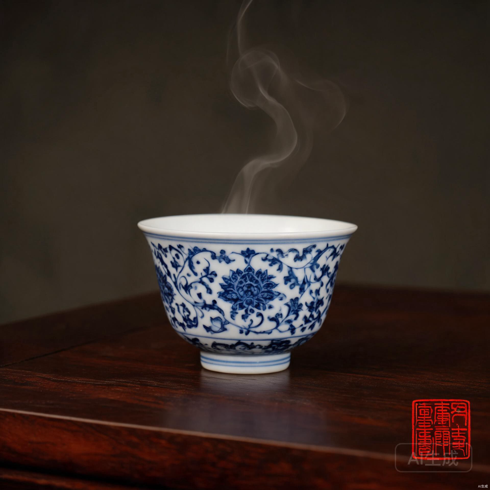
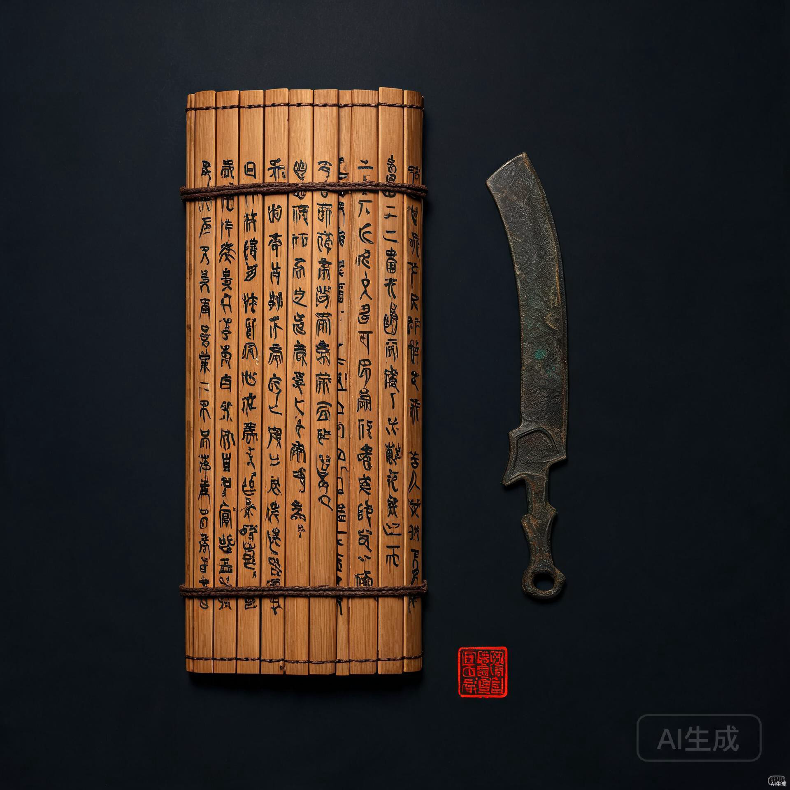

<div align="center">


# 青砚 · QingYan

### 国风 AI Agent · 四朝雅伴 · 墨韵为骨

[](./.github/workflows/ci.yml)
[](./.github/workflows/release.yml)
[](./LICENSE)
[](#下载安装)
[](./CHANGELOG.md)

**研墨铺纸 · 与君清话**

一方青砚，一位懂你的国风 AI 雅伴。以墨韵为骨，以四朝为魂——宋之青绿文人、明之青花瓷韵、秦之玄墨竹简、唐之金碧辉煌，切换之间如宣纸浸墨，儒雅而不张扬。

[功能特性](#功能特性) · [四朝意境](#四朝意境) · [下载安装](#下载安装) · [快速开始](#快速开始) · [技术栈](#技术栈) · [贡献](#贡献) · [许可证](#许可证)

</div>

---

## 缘起

市面上的 AI 应用多是冷峻的工具界面——白底、卡片、冰冷的按钮。我们想做的不一样：让 AI 住进一方青砚里，用毛笔书写、用竹简传讯、用印章落款、用卷轴展开。它不只是回答问题，而是以朝代的气韵与你清话。

青砚不是堆砌国风元素，而是**造意境**——动画克制如留白，音效细若游丝，配色随朝代流转。每一个交互都试图回答一个问题：**技术能不能也有温度、有风骨、有文脉？**

## 功能特性

### 朝代主题系统

四朝各有独立审美宇宙，切换朝代即切换整套视觉与文风：

- **配色**：CSS 变量驱动，全局自适应
- **字体**：每朝对应不同的书法/衬线字体组合
- **文风**：朝代 `promptHint` 注入大模型，指引典据与文风取向
- **切换过渡**：墨染过渡——薄墨自右上角晕开，朝代字居中浮现，墨色褪去露出新朝代色

### 开场动画

首屏毛笔逐字书写朝代名句（如"一蓑烟雨任平生"），钤"入境"朱印，时空穿越过渡至主应用。

### 卷轴输入框

双轴头横向卷轴造型，首页入场时自中间向两侧缓缓展开，配宣纸摩擦音效。

### 国风对话流

- **竹简**：用户消息以竹简形呈现
- **信笺**：AI 回信以宣纸信笺呈现，带朱印落款
- **研思录**：思考链抽屉，记录 AI 推理过程
- **案头翰墨索引**：左侧对话主题导航
- **行军图/手札记忆**：右侧任务规划与对话记忆双面板

### 四朝思考动画

AI 思考时，按当前朝代显示专属器物动画（非通用 loading）：

| 朝代 | 动作 | 器物动画 |
|------|------|---------|
| 宋 | 研墨凝思 | 墨锭绕砚打圈 + 墨池渐深 + 研磨涟漪 |
| 明 | 瀚茗澄心 | 茶盏蒸汽袅袅 + 茶汤晃动 + 液面高光 |
| 秦 | 刻简沉吟 | 刻刀落简 + 木屑坠落 + 新刻笔痕 |
| 唐 | 煎茶涤虑 | 风炉火苗跳动 + 余烬冉冉 + 蒸汽 |

### 环境音系统

Web Audio API 纯合成，零外部音频资源：

- 朝代切换：五声音阶钟磬三声
- 卷轴展开：宣纸摩擦
- 落笔送出 / 收信完成：毛笔一拂 / 一声清磬
- 思考中：四朝专属循环环境音（研墨闷响/水沸气泡/刻木短响/火声噼啪）
- 导航栏静音切换，状态持久化

### 知识库 RAG

华夏典籍种子库 + 检索增强生成，AI 回信有典有据。

### 桌面应用

Electron 打包，支持 Windows / macOS（Intel + Apple Silicon）/ Linux 三平台原生安装包。

## 四朝意境

<div align="center">
<table>
<tr>
<td align="center"><br><b>宋 · 青砚</b><br>青绿山水 · 文人雅致</td>
<td align="center"><br><b>明 · 青花</b><br>青花瓷韵 · 富丽端庄</td>
</tr>
<tr>
<td align="center"><br><b>秦 · 玄墨</b><br>玄墨竹简 · 肃穆古拙</td>
<td align="center"><br><b>唐 · 紫毫</b><br>金碧辉煌 · 大唐气象</td>
</tr>
</table>
</div>

每朝自有标语、印章、落款自称、思考雅词：

- **宋**：研墨铺纸 · 与君清话 / 拟宋 / 青砚谨复 / 研墨凝思
- **明**：青花为骨 · 匠心为魂 / 拟明 / 青花谨复 / 瀚茗澄心
- **秦**：以法为度 · 以墨为言 / 拟秦 / 玄墨谨复 / 刻简沉吟
- **唐**：提笔赋咏 · 大唐风华 / 拟唐 / 紫毫谨复 / 煎茶涤虑

## 下载安装

### 桌面应用（推荐）

前往 [Releases](../../releases/latest) 下载对应平台安装包：

| 平台 | 文件 | 说明 |
|------|------|------|
| Windows | `QingYan-1.0.0-win-x64.exe` | NSIS 安装程序 |
| macOS (Apple Silicon) | `QingYan-1.0.0-mac-arm64.dmg` | M1/M2/M3 |
| macOS (Intel) | `QingYan-1.0.0-mac-x64.dmg` | Intel Mac |
| Linux | `QingYan-1.0.0-linux-x64.AppImage` | 免安装直接运行 |

> **macOS 提示**：因未提供 Apple 开发者签名，首次打开可能提示"无法验证开发者"。右键点击应用 → 打开 → 仍要打开，即可正常使用。

### Web 版

在线演示：**https://remyoli77.github.io/qingyan/**

> 推送到 `main` 分支后,GitHub Actions 会自动构建并发布到 GitHub Pages。

## 快速开始

### 环境要求

- Node.js 20+
- npm 10+

### Web 开发模式

```bash
git clone https://github.com/remyoli77/qingyan.git
cd qingyan
npm install
npm run dev
```

浏览器访问 `http://localhost:5173`。

### Electron 桌面开发模式

```bash
npm run dev:electron
```

会同时启动 Vite 与 Electron 窗口，支持热更新。

### 构建

```bash
# Web 构建产物（dist/）
npm run build

# 当前平台桌面安装包（release/）
npm run dist:win    # Windows
npm run dist:mac    # macOS
npm run dist:linux  # Linux

# 类型检查 / Lint
npm run check
npm run lint
```

## 技术栈

| 层 | 技术 |
|----|------|
| 框架 | React 18 + TypeScript 5 |
| 构建 | Vite 6 |
| 样式 | Tailwind CSS 3 + CSS 变量（朝代主题） |
| 状态 | Zustand 5（持久化中间件） |
| 路由 | React Router 7 |
| 桌面 | Electron 33 + electron-builder 25 |
| 音效 | Web Audio API（纯合成） |
| AI | 知识库 RAG + LLM 接口 |
| CI/CD | GitHub Actions |

## 项目结构

```
qingyan/
├── electron/              # Electron 主进程与预加载
│   ├── main.cjs
│   └── preload.cjs
├── src/
│   ├── components/        # 国风组件 · 卷轴/竹简/信笺/印章/思考器物
│   ├── pages/             # Home 首页 / Chat 对话页
│   ├── store/             # zustand · 主题/对话/设置
│   ├── lib/               # 知识库/RAG/LLM/环境音/应用就绪事件
│   ├── data/              # 功能特性/种子知识/对话模拟
│   ├── App.tsx
│   ├── main.tsx
│   └── index.css          # 全局样式 · 朝代主题变量
├── .github/
│   ├── workflows/         # CI 检查 + Release 多平台构建
│   ├── ISSUE_TEMPLATE/
│   └── PULL_REQUEST_TEMPLATE.md
├── docs/images/           # 宣传图与截图
├── build/                 # 桌面应用图标资源
├── electron-builder.yml   # 三平台打包配置
├── tailwind.config.js     # 主题色 token + 动画 keyframes
└── index.html             # 入口 · 含开场动画 inline script
```

## 贡献

我们欢迎各种形式的贡献——一处错字、一个动画细节、一整段朝代意境的打磨，甚至是一句诗词典据的修正。

详见 [CONTRIBUTING.md](./CONTRIBUTING.md)。本项目最稀缺的不是代码，而是**有格调的朝代内容**。

请遵守 [Code of Conduct](./CODE_OF_CONDUCT.md)——儒雅、尊重、建设性，与项目气质一致。

## 路线图

- [ ] 多语言界面（中/英）
- [ ] 自定义朝代主题（用户上传配色与字体）
- [ ] 离线模式（本地小模型）
- [ ] 移动端适配优化
- [ ] 更多朝代（汉/魏晋/清）
- [ ] 语音朗读（朝代声线）

详见 [ROADMAP](https://github.com/remyoli77/qingyan/discussions) 与 Discussions 区。

## 许可证

[MIT License](./LICENSE) · Copyright © 2025 青砚 QingYan

## 致谢

- 字体：[Ma Shan Zheng](https://fonts.google.com/specimen/Ma+Shan+Zheng) · [Noto Serif SC](https://fonts.google.com/specimen/Noto+Serif+SC) · [ZCOOL XiaoWei](https://fonts.google.com/specimen/ZCOOL+XiaoWei)
- 灵感源自宋画山水、明青花瓷、秦汉简牍、唐人丹青
- 感谢每一位愿意以代码续文脉的贡献者

---

<div align="center">

**以青绿为骨 · 以宋韵为魂**

愿与诸君共研此砚

</div>
